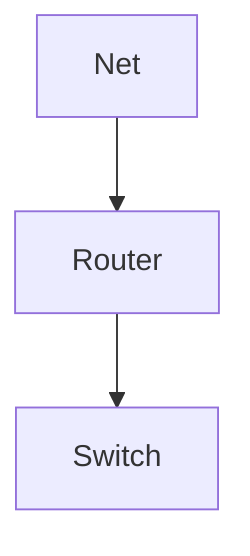

# New session - 2026-09-15T04:35:26.704Z

**Session ID:** ses_f5ca6ce8fffePvybWKaeuib804
**Created:** 9/15/2026, 11:35:26 AM
**Updated:** 9/15/2026, 11:36:52 AM

---

## User

bantu saya list semua format dari obsidian 

---

## Assistant (Build · Big Pickle · 23.9s)

_Thinking:_

The user is asking in Indonesian (casual/peer register) to help list all formats for Obsidian. This is about Obsidian markdown formats/syntax. Since it's a CLI tool, I should provide a concise but complete list of Obsidian's Markdown format support.

Let me think about what "format dari obsidian" means - they probably want the Markdown syntax formats supported by Obsidian. This is an informational question, so I should answer concisely but this is a case where detail is warranted since user asks to "list all formats."

Let me provide the list of Obsidian Markdown formats. I'll respond in Indonesian casual language (lo/gue style per AGENTS.md).

The core Markdown formats in Obsidian include:
- Headings (#, ##, ###)
- Bold, italic, strikethrough, highlight
- Links [[wikilinks]], external links, embeds ![[...]]
- Lists (bulleted, numbered, task lists with checkboxes)
- Quotes
- Code blocks (with syntax highlighting)
- Callouts
- Tables
- Horizontal rules
- Images
- Footnotes
- Tags (#tag)
- Math ($...$, $$...$$)
- Diagrams (Mermaid)
- Metadata (YAML frontmatter)
- Obsidian-specific: canvas, dataview (plugin)

Let me write this concisely with examples. Since this is informational, I can be a bit more detailed but still keep it tidy. The user wants a complete list, so a table or list format would work.

I should keep response relatively concise but this warrants a comprehensive answer since they asked to list all formats. Let me structure it well.

Oke gue list semua format Markdown di Obsidian, dari yang standar sampai yang khusus Obsidian:

## Markdown Standar
| Format | Sintaks |
|---|---|
| Heading | `# H1` sampai `###### H6` |
| Bold | `**teks**` atau `__teks__` |
| Italic | `*teks*` atau `_teks_` |
| Bold + Italic | `***teks***` |
| Strikethrough | `~~teks~~` |
| Highlight | `==teks==` |
| Inline code | `` `kode` `` |
| Code block | ```` ```python ```` |
| Quote | `> teks` (bisa nested `>>`) |
| Bullet list | `- item` / `*` / `+` |
| Numbered list | `1. item` |
| Task list | `- [ ] todo` / `- [x] done` |
| Line break | 2 spasi + enter, atau `\` + enter |
| Horizontal rule | `---` / `***` / `___` |
| Link eksternal | `[teks](https://...)` |
| Image eksternal | `` |
| Table | `\| kolom1 \| kolom2 \|` |
| Footnote | `teks[^1]` lalu `[^1]: isi` |
| Comments | `%% ini komentar, gak keliatan %%` |

## Khusus Obsidian
- **Wikilink / internal link**: `[[Nama Catatan]]`, bisa bervariasi `[[Catatan|alias]]` atau `[[Catatan#^blockid]]`
- **Embed**: `![[Catatan]]`, `![[gambar.png]]`, bisa embed video/audio/PDF juga
- **Tag**: `#tagname`
- **Callout**: `> [!note]`, `> [!warning]`, `> [!tip]`, `> [!danger]`, `> [!example]`, `> [!quote]`, dll (bisa custom + fold `> [!tldr]-`)
- **Math / LaTeX**: `$inline$` dan `$$block$$`
- **Diagram Mermaid**: ` ```mermaid ` (flowchart, sequence, class, dll)
- **YAML frontmatter** (metadata): `---` di awal file untuk alias, tags, cssclasses, dll
- **Block reference**: tag `^blockid` di akhir paragraf buat referensi spesifik
- **`Ctrl+click` pada link** buat preview dll (bukan format tapi fitur)

## Format Lain (ekstensi/plugin umum)
- **Dataview** (plugin): ```` ```dataview ```` buat query daftar catatan pakai metadata
- **Templater** (plugin): template scripting
- **Canvas** (bukan markdown, file `.canvas` — whiteboard)
- Obsidian **Web Clipper** `![[...]]` embed

Mau gue bikin contoh satu file nyoba test semua format sekaligus?

---

## User

gue pengen format lengkapnya bro semua!

---

## Assistant (Build · Big Pickle · 34.2s)

_Thinking:_

The user wants a complete list of ALL Obsidian formats. They're saying "gue pengen format lengkapnya bro semua!" - they want the complete/expanded formats for everything.

Let me think about what they want. Probably they want detailed examples of each format so they can see how it works. Let me create a comprehensive test file that demonstrates all formats, since that would be hands-on learning which matches their learning style (belajar lewat praktik).

Actually, re-reading: "gue pengen format lengkapnya bro semua" - could mean "I want the complete format for all of them bro". So they want the full syntax demonstrated for each format type.

Given the user is hands-on learner, maybe I should offer to create a comprehensive markdown test file in their vault. But let me ask where their Obsidian vault is, or just provide the full detailed list.

Let me provide a truly comprehensive reference with full examples for each. This is an informational request so I can be detailed. The response should be thorough since they explicitly asked for "semua" (everything).

Let me structure it really comprehensively - full syntax + example for every format including:
- All heading levels
- Emphasis variants
- Blockquotes (nested)
- Lists (ordered, unordered, nested)
- Task lists
- Code blocks with language highlighting
- Tables (alignment)
- Links (internal, external, headers, blocks)
- Embeds
- Images
- Footnotes
- Highlights
- Tags
- Comments
- Callouts (all types)
- Math
- Mermaid
- Frontmatter
- Horizontal rules
- Line breaks
- Escape characters
- HTML support
- Obsidian specifics: alias properties, block reference, H1 in embeds, etc.

I'll write it out fully. Since it's a lot, maybe offering to write it to a file for test would be good. Let me first give the full breakdown in chat, and offer to save it as a test file in the vault. Actually the user learns by doing - best to write it into an actual file they can open in Obsidian. Let me find the vault location first.

Let me ask where the vault is, or check common locations. Actually let me just present the complete format and offer to save it. Given their style, creating a file would be ideal. Let me check if I can find the Obsidian vault path.

I'll provide the comprehensive reference in chat, and offer to save it as a test note. Keep it organized. This will be long but that's what they asked for.

Oke, gue kasih **format lengkap + contoh** biar langsung kebayang. Nanti gue tawarin buat jadiin file test di vault lo.

## 1. Heading
```
# H1
## H2
### H3
#### H4
##### H5
###### H6
```
Catatan: pakai `#` aja, bukan setext (`=` / `-` di bawah).

## 2. Penekanan Teks
```
**bold**          → bold
*italic*          → italic
_italic_          → italic (alternatif)
***bold italic*** → ketiganya
~~strikethrough~~ → coret
==highlight==     → highlight kuning
==*kombinasi*==   → highlight + italic
```
Backslash buat escape karakter: `\*\*bukan bold\*\*`.

## 3. Links
```
// Eksternal
[Google](https://google.com)
[Contoh Phrase](https://example.com "Tooltip title")

// Internal (Wikilink)
[[Catatan Lain]]
[[Catatan Lain|alias tampilan]]
[[Catatan Lain#Judul Section]]
[[Catatan Lain#^block-id]]      // blok tertentu
[[Catatan Lain|alias#+embed]]   // embed spesifik

// Sinek kaya "gak ada di graph"
[[Catatan Baru]]                // klik buat bikin
```

## 4. Embed (`!` paling depan)
```
![[Catatan]]                // embed note
![[gambar.png]]             // embed gambar
![[audio.mp3]]              // embed audio
![[video.mp4]]              // embed video
![[file.pdf#page=5]]        // PDF halaman 5
![[https://...]]            // embed website (dengan plugin)
```
`[[catatan]]` tembus `/` kalau lo tahan `Cmd`/`Ctrl` + klik.

## 5. Gambar
```

![[lokal.png]]
```
Ukuran/crop/resize (pakai HTML atau fitur edit mode):
```
![[gambar.png|200]]        // resize lebar 200px
![[gambar.png|200x150]]    // resize & crop
```

## 6. List
```
// Unordered
- Item
- Item
  - Sub item      // indent 2/4 spasi
    - Sub-sub

// Ordered
1. Pertama
2. Kedua
   1. Sub
   2. Sub

// Task list
- [ ] belum
- [x] selesai
- [x] @@{2024-01-01}      // tanggal due (kalender)
```

## 7. Quote (Blockquote)
```
> Quote satu baris
>
> > Nested quote
```
Bisa ganda: `>> gabisa > custom > > lol` - kombinasi.

## 8. Code
```
`inline code`

```json
{
  "key": "value"
}
```

```python
def halo():
    print("yo")
```
Bahasa yang dikenali linimasa: json, python, yaml, bash, js, ts, html, css, dll (Markdown Cookbook).

## 9. Table
```
| Nama  | Umur | Kota      |
|-------|:----:|----------:|
| Enggar|  27  |  Sukabumi |
| Uke   |  25  |  Bogor    |

:--- left, :---: center, ---: right
```
Tanpa preview = tetap render di Reading Mode.

## 10. Footnote
```
Teks[^1] lebih lanjut.

[^1]: Penjelasan footnote.
[^2]: Bisa banyak, format bebas.
```
Bisa definisikan di mana aja di file.

## 11. Tag
```
#tagname
#tagname/nested        // tag dengan dash, nested dipisah "/"
```
Ada di tag pane, clickable di graph view.

## 12. Callout (fitur khas Obsidian)
```
> [!note]
> Teks callout.

> [!warning]+ Callout dengan nama & expanded
> Konten.

> [!check]- Bisa foldable
> Tersembunyi sampe di-klik.

> [!danger] Judul
> Isi bisa **bold** juga.
```
Tipe bawaan:
```
note, abstract, summary, tldr, info, todo, tip, hint, important,
success, check, done, question, help, faq, warning, caution,
attention, danger, error, bug, example, quote, cite
```
Warna ikon beda-beda, bisa custom CSS.

## 13. Math / LaTeX
```
$inline\ math$
$$ block \ math $$
$$ \begin{aligned}
x &= ax + b
\end{aligned} $$
```
Ditag bisa di line kebebasan. Live preview render malah bagus.

## 14. Mermaid Diagram
```


sequenceDiagram, classDiagram, stateDiagram, gantt, pie, journey, dll
```

## 15. YAML frontmatter (metadata)
```
---
title: Judul
aliases: [alias1, alias2]
tags: [linux, devops]
cssclasses: my-style
date: 2026-09-15
author: Enggar
---
```
Ditempatin paling atas file, diapit `---`. Bisa appa apa aja: properties, canvas embed, deeplink.

## 16. Block Reference
```
// di akhir paragraf/menambahkan:
^abc123

// referensi:
[[Catatan#^abc123]]
```
Id unik, bisa di-embed/si-action.

## 17. Misc Catatan
```
// Horizontal rule
---
***
___

// Comments (hidden)
%% ini gak keliatan di reading mode %%

// New line dalam list/tabel
- Item\
  masih baris sama            // line break pakai backslash

// HTML supported
<mark>teks</mark>, <em>, <strong>, <u>, <br>, <div>, <style>
```
HTML & CSS custom class (`.cssclasses` + `obsidian` snippet) bisa styling per-note.

---

Kebayang semua. Lo mau gue bikin **file `.md` nyobaan** sekaligus di vault Obsidian lo (bisa langsung preview & edit), biar format langsung keliatan? Kalau iya, bilang aja path vault lo.

---

